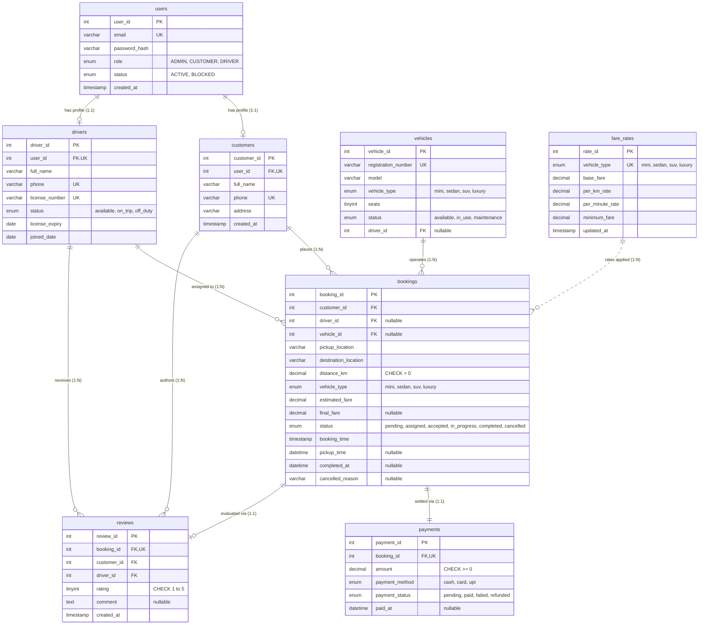

# Taxi Service Management System (DBMS Course Project)

A production-grade, full-stack **Taxi Service Management System** designed specifically for university Database Management Systems (DBMS) lab evaluations, practical demonstrations, and viva examinations.

Built strictly with **React 18 + Vite + Tailwind CSS**, **Node.js + Express.js**, and an **Oracle MySQL 8.0 (InnoDB)** relational database engine.

---

## 📋 Table of Contents
1. [Architecture & System Overview](#-architecture--system-overview)
2. [Database Design & Normalization (3NF)](#-database-design--normalization-3nf)
3. [Mermaid Entity-Relationship (ER) Diagram](#-mermaid-entity-relationship-er-diagram)
4. [Relational Schema & Constraints](#-relational-schema--constraints)
5. [Performance Indexes, Views, Procedures & Triggers](#-performance-indexes-views-procedures--triggers)
6. [SQL Query Explorer (48 Catalog Queries)](#-sql-query-explorer-48-catalog-queries)
7. [Default Demo Accounts](#-default-demo-accounts)
8. [Quick Start & Setup Instructions](#-quick-start--setup-instructions)
9. [REST API Specification](#-rest-api-specification)
10. [College DBMS Viva Questions & Model Answers (15+)](#-college-dbms-viva-questions--model-answers)

---

## 🏛 Architecture & System Overview

```
                      +------------------------------------------+
                      |         React.js (Vite + Tailwind)       |
                      |        Role-Based Portals:               |
                      |  - Public Landing, Login, Registration   |
                      |  - Customer: Booking, Rides, Receipts    |
                      |  - Driver: Trips Dispatch, Reviews       |
                      |  - Admin: Fleet, Dispatch, SQL Explorer  |
                      +--------------------+---------------------+
                                           | HTTP / REST (JWT)
                                           v
                      +------------------------------------------+
                      |         Node.js + Express.js API         |
                      |  - JWT Auth Guard & Role RBAC Middleware |
                      |  - ACID Transactional Booking Lifecycle  |
                      |  - Server-Side Distance & Fare Calculator|
                      |  - Query Catalog Service (48 Queries)    |
                      +--------------------+---------------------+
                                           | mysql2 / Promise Pool
                                           v
                      +------------------------------------------+
                      |         MySQL 8.0.37 (InnoDB Engine)     |
                      |  - 8 Relational Tables (3NF Normal Form) |
                      |  - Deliberate FK Actions (RESTRICT/CASC) |
                      |  - Views: v_booking_details, v_daily_rev |
                      |  - Stored Procedures: sp_assign_driver   |
                      |  - Triggers: trg_after_booking_status    |
                      +------------------------------------------+
```

---

## 📐 Database Design & Normalization (3NF)

The database schema strictly adheres to **Third Normal Form (3NF)**:

1. **First Normal Form (1NF)**:
   - Every column contains atomic (indivisible) values. No repeating groups or comma-separated lists are stored.
   - Every relation has a defined Primary Key (`user_id`, `customer_id`, `driver_id`, `vehicle_id`, `booking_id`, `payment_id`, `review_id`, `rate_id`).

2. **Second Normal Form (2NF)**:
   - The database is in 1NF and contains **zero partial dependencies**.
   - Every non-key attribute is fully functionally dependent on the primary key, as all tables employ single-attribute surrogate integer primary keys.

3. **Third Normal Form (3NF)**:
   - The database is in 2NF and contains **zero transitive dependencies** ($X \rightarrow Y$ and $Y \rightarrow Z$ where $Z$ is a non-prime attribute).
   - *Example*: In `bookings`, we store only `customer_id`, `driver_id`, and `vehicle_id`. We do not duplicate customer contact numbers, vehicle registration numbers, or driver license numbers into the `bookings` table. Instead, relationships are resolved at query time via relational `INNER JOIN` operations or through the predefined view `v_booking_details`.

### Referential Integrity & Foreign Key Actions
- **`ON DELETE CASCADE`** (`users -> customers`, `users -> drivers`): If a user credentials record is deleted, their corresponding profile is automatically removed.
- **`ON DELETE RESTRICT`** (`customers -> bookings`, `drivers -> bookings`, `vehicles -> bookings`, `bookings -> payments`): Protects financial audits and legal trip history. An administrator cannot delete a customer, driver, or vehicle that has historical bookings on record. The database engine rejects the operation with error `ER_ROW_IS_REFERENCED_2`.

---

## 📊 Mermaid Entity-Relationship (ER) Diagram



---

## ⚡ Performance Indexes, Views, Procedures & Triggers

### 1. Secondary Indexes
Beyond primary and foreign key indexes, 7 composite and filtering indexes are created:
1. `idx_bookings_status` on `bookings(status)`: Optimizes state-machine lifecycle filtering (`pending`, `completed`, `assigned`).
2. `idx_bookings_time` on `bookings(booking_time)`: Speeds up date-range queries (`BETWEEN`) and monthly revenue aggregation.
3. `idx_bookings_customer_status` on `bookings(customer_id, status)`: Composite index for fast customer dashboard queries.
4. `idx_bookings_driver_status` on `bookings(driver_id, status)`: Composite index for driver active assignment lookups.
5. `idx_vehicles_status_type` on `vehicles(status, vehicle_type)`: Composite index for real-time dispatch matching.
6. `idx_drivers_status` on `drivers(status)`: Accelerates finding online/available chauffeurs.
7. `idx_payments_status` on `payments(payment_status)`: Speeds up financial ledger and unpaid cash auditing.

### 2. Relational View: `v_booking_details`
Provides a consolidated view combining 5 relations for reporting and trip sheets:
```sql
CREATE OR REPLACE VIEW v_booking_details AS
SELECT 
    b.booking_id,
    b.status AS booking_status,
    b.pickup_location,
    b.destination_location,
    b.distance_km,
    b.estimated_fare,
    b.final_fare,
    b.booking_time,
    b.completed_at,
    c.customer_id,
    c.full_name AS customer_name,
    c.phone AS customer_phone,
    d.driver_id,
    d.full_name AS driver_name,
    d.phone AS driver_phone,
    v.vehicle_id,
    v.registration_number,
    v.model AS vehicle_model,
    v.vehicle_type,
    p.payment_id,
    p.amount AS payment_amount,
    p.payment_method,
    p.payment_status,
    r.rating,
    r.comment AS review_comment
FROM bookings b
JOIN customers c ON b.customer_id = c.customer_id
LEFT JOIN drivers d ON b.driver_id = d.driver_id
LEFT JOIN vehicles v ON b.vehicle_id = v.vehicle_id
LEFT JOIN payments p ON b.booking_id = p.booking_id
LEFT JOIN reviews r ON b.booking_id = r.booking_id;
```

### 3. Stored Procedure: `sp_assign_driver`
Encapsulates atomic dispatch validation and state transition:
```sql
CALL sp_assign_driver(p_booking_id, p_driver_id, p_vehicle_id);
```

### 4. Trigger: `trg_after_booking_status_update`
Automatically toggles driver and vehicle availability to `on_trip`/`in_use` when assigned, and resets them to `available` upon ride completion or cancellation.

---

## 🔍 SQL Query Explorer (48 Catalog Queries)

The system features a dedicated **SQL Query Explorer** (`/admin/sql-explorer`) with a catalog of 48 queries across all **16 DBMS syllabus categories**:

1. **Basic SQL**: Column projections, `DISTINCT` deduplication, sorting (`ORDER BY`).
2. **CRUD Operations**: Demonstrations of `INSERT`, `UPDATE`, and `DELETE`.
3. **Joins**: 2-table `INNER JOIN`, 5-table multi-join (`v_booking_details`), and `LEFT JOIN` for unassigned entities.
4. **Aggregate Functions**: Financial metrics using `COUNT`, `SUM`, `AVG`, `MIN`, and `MAX`.
5. **GROUP BY & HAVING**: Category trip distributions, filter riders with `HAVING COUNT(*) > 3`.
6. **Subqueries**: Scalar subquery (`WHERE fare > (SELECT AVG(fare))`), `EXISTS` correlated subquery, and `NOT IN` subquery.
7. **Constraints & Relationships**: `CHECK (rating BETWEEN 1 AND 5)` enforcement, Primary/Foreign Key rules, and `RESTRICT` violation demo.
8. **Transactions**: Complete ACID transaction demonstrating `START TRANSACTION`, `COMMIT`, and `ROLLBACK`.
9. **Views & Indexes**: Inspecting `v_booking_details`, query optimization with `EXPLAIN` analysis.
10. **Stored Procedures & Triggers**: Demonstrating `CALL sp_assign_driver()` and trigger inspection via `information_schema`.
11. **Customer Management**: Rider search, total spend rankings, customers who never booked (`LEFT JOIN ... WHERE b.booking_id IS NULL`).
12. **Driver Management**: Available chauffeur lookup, top rated chauffeurs, drivers never assigned.
13. **Booking Management**: Lifecycle filtering, date filtering using `BETWEEN`, high-value rides.
14. **Vehicle Management**: Fleet availability inventory, category distribution, vehicle utilization.
15. **Payment & Revenue Reports**: Gross vs settled revenue by month, breakdown by payment method (`cash`, `upi`, `card`).
16. **Advanced DBMS Queries**: Correlated subqueries, `CASE WHEN` conditional pivoting, and cancellation rate percentages.

### Live Execution Runner & Security Guard
- Every catalog query can be executed live against the real MySQL 8 database directly from the UI.
- Strict security verification enforces that only read-only queries (`SELECT`, `EXPLAIN`, `CALL`, `SHOW`) can be triggered live; educational DDL/DML examples are safely displayed with line-by-line pedagogical annotations.

---

## 🔑 Default Demo Accounts

All pre-seeded demo accounts share the uniform password: **`Password123!`**

| Role | Email | Password | Description |
| :--- | :--- | :--- | :--- |
| **Admin** | `admin@taxiservice.com` | `Password123!` | Full fleet management, dispatch console, reports, and SQL Explorer |
| **Customer 1** | `rahul.sharma@example.com` | `Password123!` | High-volume rider (multiple completed bookings) |
| **Customer 2** | `priya.patel@example.com` | `Password123!` | Active customer with pending and completed rides |
| **Customer 11** | `pooja.joshi@example.com` | `Password123!` | Special demo user: Registered customer who has **never booked** |
| **Driver 1** | `suresh.driver@example.com` | `Password123!` | Top rated driver operating sedan vehicle |
| **Driver 8** | `karan.driver@example.com` | `Password123!` | Special demo user: Active driver who was **never assigned** |

*(Quick-login buttons on the `/login` page allow 1-click credential filling for all roles).*

---

## 🚀 Quick Start & Setup Instructions

### Prerequisites
- Windows OS (or macOS/Linux with MySQL 8 installed)
- Node.js (v18+) and npm (v9+)

### Option A: One-Click Startup (Windows)
Double-click `start-all.bat` in the project root folder. It will sequentially launch:
1. Portable Oracle MySQL 8.0 Daemon on port `3306`
2. Node.js Express API Server on port `5000`
3. React Vite Development Server on `http://localhost:5173`

### Option B: Manual Terminal Execution

#### 1. Start MySQL Server
```powershell
# From project root:
.\start-mysql.bat
```

#### 2. Start Backend API
```powershell
cd backend
npm install
npm run setup:db     # Runs schema.sql and populates sample_data.sql
npm run verify:queries # Verifies all catalog queries against MySQL
node server.js       # Starts API at http://localhost:5000
```

#### 3. Start Frontend UI
```powershell
cd frontend
npm install
npm run dev          # Starts Vite at http://localhost:5173
```

---

## 📡 REST API Specification

### Authentication (`/api/auth`)
- `POST /api/auth/register` - Register new customer account
- `POST /api/auth/login` - Authenticate user & issue JWT
- `GET /api/auth/me` - Fetch profile of currently authenticated user

### Bookings Workflow (`/api/bookings`)
- `POST /api/bookings` - Customer books a taxi (computes server-side fare)
- `GET /api/bookings/my-bookings` - Customer retrieves own trip history
- `PUT /api/bookings/:id/cancel` - Customer or Admin cancels booking
- `GET /api/bookings/driver-trips` - Driver fetches assigned trips
- `PUT /api/bookings/:id/driver-status` - Driver transitions trip (`accepted` $\rightarrow$ `in_progress` $\rightarrow$ `completed`)
- `PUT /api/bookings/:id/assign` - Admin dispatches driver and vehicle to ride

### SQL Query Explorer (`/api/sql-explorer`)
- `GET /api/sql-explorer/queries` - Query catalog with category filter and search
- `GET /api/sql-explorer/queries/:id` - Query metadata with line-by-line explanation
- `POST /api/sql-explorer/run/:id` - Execute query live on MySQL 8 and return timings

### Reports (`/api/reports`)
- `GET /api/reports/summary` - Computes all 8 predefined DBMS analytical reports

---

## 🎓 College DBMS Viva Questions & Model Answers

### Q1: What is the difference between 2NF and 3NF? How does this project achieve 3NF?
> **Answer**: 
> - **2NF** requires that the relation is in 1NF and contains **no partial dependencies** (every non-key attribute must depend on the whole candidate key, not a subset). Since all tables here use single-attribute surrogate keys (`customer_id`, `booking_id`), partial dependencies are naturally impossible.
> - **3NF** requires that the relation is in 2NF and contains **no transitive dependencies** ($X \rightarrow Y$ and $Y \rightarrow Z$).
> - In this project, `bookings` stores only `customer_id`, `driver_id`, and `vehicle_id`. It does **not** store customer addresses, driver phone numbers, or vehicle license plates. Storing driver phone inside `bookings` would create a transitive dependency (`booking_id -> driver_id -> driver_phone`). Resolving these via foreign keys achieves strict 3NF.

### Q2: What are ACID properties and where are they implemented in this project?
> **Answer**:
> - **Atomicity**: An operation succeeds completely or leaves the database unchanged. In `bookingService.js`, completing a ride performs: (1) booking status update to `completed`, (2) payment record update to `paid`, (3) resetting driver status to `available`, and (4) resetting vehicle status to `available`. All 4 statements execute inside a single MySQL transaction (`connection.beginTransaction()`). If any update fails, `connection.rollback()` undoes all partial updates.
> - **Consistency**: The database transitions only between valid states satisfying all constraints (`CHECK (distance_km > 0)`, `CHECK (rating BETWEEN 1 AND 5)`, unique emails, and valid FK references).
> - **Isolation**: Concurrent transactions do not interfere with each other. MySQL InnoDB default isolation level is `REPEATABLE READ`, using row-level locking (MVCC).
> - **Durability**: Once a transaction commits (`connection.commit()`), changes are written to the InnoDB write-ahead redo log (`ib_logfile`) and survive system crashes.

### Q3: What is the purpose of Database Indexes, and what is the trade-off?
> **Answer**:
> - An index is an auxiliary data structure (typically a **B+ Tree** in MySQL InnoDB) that allows the query optimizer to locate rows in $O(\log N)$ time rather than performing a full table scan ($O(N)$).
> - In this project, we added `CREATE INDEX idx_bookings_status ON bookings(status)` because dispatch operators frequently filter by status (`pending`, `completed`).
> - **Trade-off**: Indexes consume additional disk space and introduce overhead on `INSERT`, `UPDATE`, and `DELETE` operations because the B+ Tree must be rebalanced upon modifications. Indexes should therefore be created on high-cardinality columns used in `WHERE`, `JOIN`, and `ORDER BY` clauses.

### Q4: Explain the difference between `INNER JOIN`, `LEFT JOIN`, and `RIGHT JOIN`.
> **Answer**:
> - `INNER JOIN`: Returns only rows where there is a matching key in both relations. Example: `bookings JOIN customers` returns bookings that have a valid customer.
> - `LEFT JOIN`: Returns all rows from the left table, and matching rows from the right table; if no match exists, NULL values are returned. Example: `drivers LEFT JOIN bookings` allows us to identify drivers who have **never been assigned** any trips (`WHERE b.booking_id IS NULL`).
> - `RIGHT JOIN`: Mirror opposite of `LEFT JOIN`, returning all rows from the right table.

### Q5: What is the difference between `WHERE` and `HAVING` in SQL?
> **Answer**:
> - `WHERE` filters individual rows **before** any grouping or aggregation takes place. It cannot contain aggregate functions (`WHERE SUM(amount) > 500` is illegal).
> - `HAVING` filters aggregated groups **after** the `GROUP BY` clause is evaluated.
> - Example in our catalog (Query #10):
>   ```sql
>   SELECT customer_id, COUNT(*) AS ride_count
>   FROM bookings
>   GROUP BY customer_id
>   HAVING COUNT(*) > 3;
>   ```

### Q6: Why did you use `DECIMAL` instead of `FLOAT` or `DOUBLE` for fares and money?
> **Answer**:
> `FLOAT` and `DOUBLE` use binary floating-point representation (IEEE 754), which causes rounding and precision errors (e.g., $0.1 + 0.2 = 0.30000000000000004$). For financial transactions, fares, and accounting ledgers, MySQL provides `DECIMAL(M, D)` as an exact fixed-point numeric type where numbers are stored as exact decimal digits, preventing rounding discrepancies.

### Q7: What is the difference between a Stored Procedure and a Trigger?
> **Answer**:
> - A **Stored Procedure** (`sp_assign_driver`) is explicitly invoked by an application or user using the `CALL` statement. It can accept input/output parameters, contain conditional logic, and return result sets.
> - A **Trigger** (`trg_after_booking_status_update`) is executed implicitly (automatically) by the database engine in response to a DML event (`INSERT`, `UPDATE`, or `DELETE`) on a specific table.

### Q8: What is a Database View and why is it useful?
> **Answer**:
> A **View** (`v_booking_details`) is a virtual table defined by a stored SQL query. It does not store physical data itself (unless materialized). Benefits:
> 1. **Simplification**: Simplifies complex multi-table joins into a single readable relation.
> 2. **Security**: Allows granting user permissions to specific view columns without exposing underlying tables.
> 3. **Consistency**: Centralizes report logic across different parts of the application.

### Q9: What happens when an Admin tries to delete a Customer who has past bookings?
> **Answer**:
> The foreign key constraint between `customers` and `bookings` specifies `ON DELETE RESTRICT`. MySQL InnoDB blocks the deletion and raises error `ER_ROW_IS_REFERENCED_2`. This prevents catastrophic data corruption and protects financial and legal audit trails.

### Q10: How does `EXPLAIN` work in MySQL and how do you interpret its output?
> **Answer**:
> `EXPLAIN` displays the query execution plan generated by the MySQL query optimizer. Key columns include:
> - `type`: Access method. `ALL` indicates a slow full table scan; `ref` or `range` indicates index usage; `const` indicates primary key lookup.
> - `key`: The actual index chosen by the optimizer.
> - `rows`: The estimated number of rows examined.
> - `Extra`: Additional details like `Using index` (covering index) or `Using filesort` (disk-based sorting).

---

## ⚖️ License
Educational Courseware License - Designed and structured for University Computer Science & DBMS evaluations.
