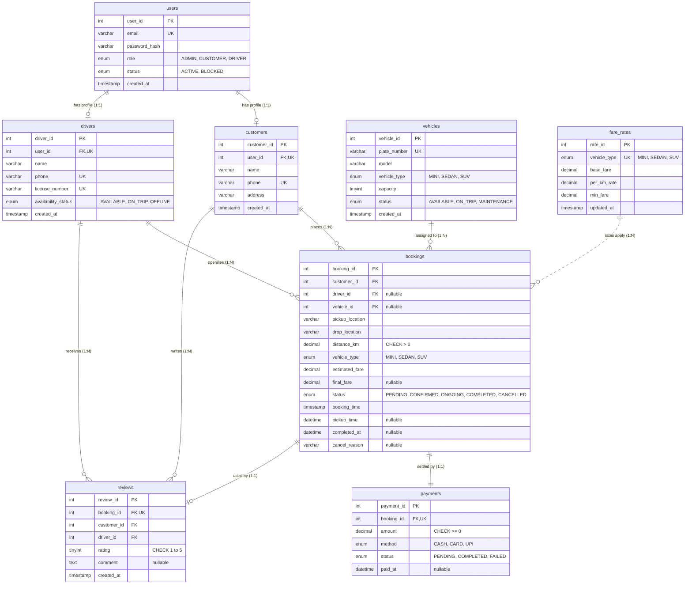

# Entity-Relationship (ER) Diagram

Taxi Service Management System database model adhering strictly to Third Normal Form (3NF), InnoDB storage engine, foreign keys, cascade/restrict rules, unique constraints, and check constraints.

## Mermaid ER Diagram

## Relational Schema & 3NF Rationale

1. **1NF**: All column values are atomic (e.g., individual pickup/drop strings, coordinates, single scalar fares, single enums).
2. **2NF**: No partial dependencies. In all tables with surrogate primary keys (`user_id`, `customer_id`, `booking_id`, etc.), every non-key column is fully functionally dependent on the entire primary key.
3. **3NF**: No transitive dependencies. Rider details (name, phone) are stored in `customers`, vehicle details (plate, model, capacity) are in `vehicles`, and driver credentials (license, status) are in `drivers`. `bookings` stores foreign keys referencing these entities without redundantly duplicating driver names or car models.
4. **Referential Integrity Actions**:
   - `users -> customers`: `ON DELETE CASCADE` removes rider profiles upon account deletion.
   - `users -> drivers`: `ON DELETE CASCADE` removes driver profiles upon account deletion.
   - `customers -> bookings`: `ON DELETE RESTRICT` protects financial trip history and audit logs.
   - `drivers -> bookings`: `ON DELETE RESTRICT` maintains driver performance records.
   - `vehicles -> bookings`: `ON DELETE RESTRICT` protects asset utilization logs.
   - `bookings -> payments`: `ON DELETE RESTRICT` guarantees financial ledger integrity.
   - `bookings -> reviews`: `ON DELETE RESTRICT` ensures verified rider review audits.
